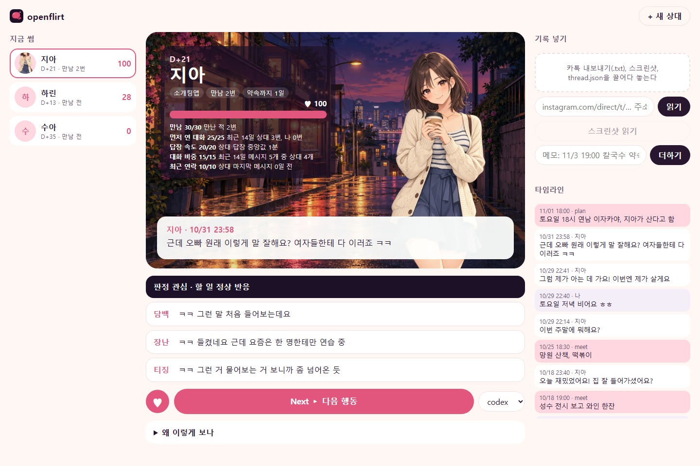

<p align="center"></p>

# openflirt

openflirt는 오픈소스 연애·플러팅 하네스다. 마픽스(마튜브)의 연애 강의 두 편, 「여자가 남자를 좋아하게 되는 과정 [완벽 총정리]」와 「여자가 쉽게 자신을 허락하는 남자 특징」의 원칙으로 연애와 썸 상황을 판정하고 다음 행동을 고른다. 썸 상대마다 카톡, 인스타 DM, 데이팅앱 스크린샷을 로컬 폴더에 모아 타임라인으로 엮고, 미연시처럼 생긴 로컬 화면에서 Next를 누를 때마다 다음 한 수를 받는다. 사람에게는 한국어로 답하고, 다른 프로그램에는 정해진 꼴의 JSON으로 답한다.



위 화면의 지아, 하린, 수아와 대화는 만든 예시 데이터이고, 판정과 세 결의 보낼 말은 그 데이터로 실제 실행한 답이다. 그림은 생성한 일러스트다.

## 썸 상대를 모아 다음 한 수 받기

```
npm ci
node bin/studio.mjs --open
```

`http://127.0.0.1:4747/`이 열린다. 오른쪽 위 **+ 새 상대**로 등록하고, 그 상대와의 카톡 대화 내보내기(.txt), 어느 앱이든 대화나 프로필 스크린샷, 인스타그램 DM 주소를 넣은 뒤 **스크린샷 읽기**와 **Next ▸ 다음 행동**을 누른다. 화면에는 며칠째인지, 잡힌 약속, 행동을 센 게이지와 그 근거, 마지막 대화, 판정과 할 일, 담백·장난·티징 세 결의 보낼 말이 뜬다. 보낼 말을 누르면 복사되고, 하트는 마음에 든 추천을 표시해 다음 추천의 질문에 들어간다. 사진을 하나만 끌어 놓으면 프로필 사진으로 쓸지 묻는다.

모든 기록은 저장소의 `crushes.local/` 아래 상대별 폴더에만 쌓이고 커밋되지 않는다(`OPENFLIRT_CRUSHES`로 위치를 바꾼다). 스크린샷 읽기와 다음 행동만 고른 런타임(codex, claude)의 모델 제공자에게 보내진다. 같은 일을 명령으로 하는 법과 폴더 구조, 게이지 계산은 [crush 스킬](skills/crush/SKILL.md)에 있고, 앞으로 붙일 MCP와 봇 연동은 [로드맵](docs/ROADMAP.md)에 있다.

## ChatGPT나 Claude에서 바로 쓰기

저장소를 받지 않아도 된다. 아래 주소 하나에 스킬 본문, 용어집, 원칙 전부가 강의 원문 인용과 함께 들어 있다.

```
https://raw.githubusercontent.com/LilMGenius/openflirt/main/llms-full.txt
```

chatgpt.com이나 claude.ai에 이렇게 붙여 넣으면 된다.

```
https://raw.githubusercontent.com/LilMGenius/openflirt/main/llms-full.txt 를 끝까지 읽고, 그 안의 SKILL.md 판단 순서와 답하는 법대로 내 연애 질문에 답해 줘. 질문: …
```

긴 파일을 중간까지만 읽는 도구라면 [llms.txt](https://raw.githubusercontent.com/LilMGenius/openflirt/main/llms.txt)를 먼저 주면 된다. 파일마다의 원본 주소가 있어 원칙 파일을 하나씩 읽을 수 있다. 두 파일은 원본 파일에서 지어 내고, 원본과 달라지면 저장소 검사가 실패하니 늘 `main`의 원본과 같다.

## 이렇게 답한다

```
node bin/openflirt.mjs "금요일에 한잔하자고 했더니 '봐서 나중에 알려줄게'래"
```

> 판정은 **마찰**이고, 할 일은 **뺌**이야.
>
> 상대가 한 행동은 하나야. 금요일에 보자는 약속 제안에 응하지 않고 "봐서 나중에 알려 줄게"라며 결정을 미뤘어. 강의는 이런 답을 **플레이크**로 봐. …
>
> > [39:38] 정말 관심이 있으면 연락을 정상적으로 돌려주고 약속 잡고 톡이나 문자나 전화에서도 자연스럽게 받아 줍니다.
>
> 그러니 할 일은 이거야. "그래" 한마디로 받고 끝내. …

답은 판정 하나와 할 일 하나로 시작하고, 근거가 된 강의 원문을 그 시각과 함께 붙인다. 위는 실제 실행에서 앞부분만 옮긴 것이다.

`--json`을 주면 같은 판단을 [schema/answer.schema.json](schema/answer.schema.json)에 맞는 JSON으로 낸다. 스키마에 맞지 않거나, `citations`의 인용이 `video`로 밝힌 강의 전문의 그 시각에 글자 그대로 없는 답은 내보내지 않는다. 아래는 같은 질문의 실제 출력이고, `answer`만 줄였다.

```json
{
  "verdict": "friction",
  "reading": "금요일 약속 제안에 상대는 수락도 다른 날 제안도 없이 '봐서 나중에 알려줄게'로 답했다. 날을 잡지 않고 결정을 미룬 플레이크다.",
  "action": "withdraw",
  "message": "그래",
  "answer": "판정은 마찰이고 할 일은 뺌이에요. …",
  "principles": ["friction", "okay-end", "meet", "reciprocity"],
  "citations": [
    { "video": "RhfqIi3DmWU", "t": "39:38", "quote": "이런 식으로 반응하면 추가 문자를 보낼 필요도 없고 설득하려고 들 필요도 없습니다." },
    { "video": "RhfqIi3DmWU", "t": "46:13", "quote": "다음에 연락 안 해요. 솔직히 말하면 연락하면 안 돼요. 사실 지가 연락하겠지. 여자가 무조건 온다니까." }
  ],
  "out_of_scope": null
}
```

판정은 관심, 애매, 마찰, 끝, 모름 다섯 가지이고, 할 일은 멈춤, 뺌, 놓음, 약속 잡기, 정상 반응, 기준 지키기, 지켜봄 일곱 가지다. 각각의 뜻과 판정마다의 기본 할 일은 [SKILL.md](skills/openflirt/SKILL.md#판정)에 있다.

## 쓰는 법

Node.js 22 이상과, 로그인해 둔 [Codex CLI](https://github.com/openai/codex) 또는 [Claude Code](https://docs.anthropic.com/en/docs/claude-code)가 필요하다.

```
git clone https://github.com/LilMGenius/openflirt
cd openflirt
npm ci
node bin/openflirt.mjs "질문"
```

- `--json`: JSON 하나로 답한다.
- `--runtime claude`: Codex 대신 Claude Code로 답한다. 기본은 `codex`다.
- `--model <id>`: 런타임에 넘길 모델을 고른다.
- `--timeout <초>`: 기다릴 시간. 기본은 600초다.
- 질문을 인자로 주지 않으면 표준 입력에서 읽는다. 긴 대화를 붙여 넣을 때 편하다.
- 카카오톡 대화 내보내기(.txt)는 질문에 파일 경로를 적어 주면 된다. 스킬이 [kakaotalk-chat](skills/kakaotalk-chat/SKILL.md)으로 `thread.json`을 만들고 [behaviors.mjs](skills/openflirt/scripts/behaviors.mjs)로 주별 연락과 답장 시간, 통화 시작, 만남 제안과 그 답을 세어 읽고, 답에는 대화 속 이름을 옮기지 않는다.
- 인스타그램 DM은 대화방 주소를 적어 주면 [instagram-dm](skills/instagram-dm/SKILL.md)이 읽어 같은 방법으로 센다. BrowserSkill의 `bsk`와 인스타그램에 로그인된 Chrome이 있어야 하고, 대화방을 스크롤하며 읽기만 한다. 헤드리스 러너의 읽기 전용 샌드박스에서는 브라우저에 닿지 못하니 Codex나 Claude Code를 이 저장소에서 열어 묻는다.

종료 코드는 성공이 0, 런타임이 실패했거나 답이 스키마나 인용 검사를 통과하지 못하면 1, 질문이 비었거나 옵션이 틀리면 2다.

Codex나 Claude Code를 이 저장소에서 열어 `$openflirt`를 부르거나 그냥 연애 질문을 해도 같은 규칙으로 답한다.

## 잘 맞는지 재 보기

둘 다 모델을 실제로 부르는 유료 실행이다. 사례나 프롬프트 하나가 모델 실행 한 번이니 `--only id,id`로 일부만 돌려 볼 수 있다. 결과는 `--out`으로 준 JSON 파일에 쓴다.

```
node scripts/eval.mjs --runtime codex --out result.json
node scripts/routing.mjs --runtime claude --out routing.json
```

- `scripts/eval.mjs`: [eval/cases.json](eval/cases.json)의 사례마다 질문을 한 번씩 던져, 강의가 그 사례에 말하는 판정과 할 일을 답이 맞혔는지 센다. 사례는 강의의 풀이 사례이고, 라벨마다 그렇게 말한 강의 원문이 붙어 있다. 판정과 할 일만 채점하고 문장은 채점하지 않는다. `--rescore result.json --out again.json`은 저장한 답을 모델 호출 없이 다시 채점한다. 사용량 제한을 만나면 남은 사례를 돌리지 않고 멈추며 종료 코드 1을 낸다.
- `scripts/routing.mjs`: [eval/routing.json](eval/routing.json)의 프롬프트 30개(스킬이 맡아야 할 20개, 맡지 않아야 할 10개)를 스킬 링크만 둔 빈 폴더에서 돌려, 질문에 `openflirt` 스킬이 불러졌는지를 이벤트 기록으로 판단하고 혼동표로 모은다.

## 알아 둘 것

- openflirt는 판정과 조언만 한다. 메시지는 직접 보낸다.
- 상대가 분명히 싫다고 했으면 해석하지 않고 끝으로 본다. 스킨십과 성적인 진행은 싫다는 말이나 망설임에서 멈춘다. 이것과 아래 몇 줄 말고는 강의가 정한 대로 답한다.
- 미성년자에 관한 일이나 상대 몰래 들여다보는 일은 돕지 않는다.
- 질문 속 부탁에 불법이거나 남을 해치는 부분이 있으면 그 부분은 돕지 않고, 관계에 대해서만 답한다.
- 질문은 고른 런타임이 쓰는 모델 제공자에게 보내진다. 붙여 넣은 대화는 상대의 개인 정보이니 이름, 연락처, 사진은 빼고 넣는다.
- 두 강의는 같은 강의자의 것이라, 서로 다르게 말하는 자리에서는 나중에 올린 강의(「여자가 쉽게 자신을 허락하는 남자 특징」)를 따른다.
- 강의 두 편은 남자가 여자를 만나는 상황을 다룬다. 그 밖의 관계에는 강의의 틀로 할 수 있는 말만 한다.
- 답은 모델이 쓰기 때문에 같은 질문에도 문장은 실행마다 다를 수 있다.

## 안에 든 것

- 강의 전문: [첫 강의](corpus/RhfqIi3DmWU/transcript.md), [두 번째 강의](corpus/F05nX3MKCD0/transcript.md). 유튜브 자동 자막을 초안으로 삼고 Whisper large-v3 전사와 화면 자막을 맞대어 고쳤다. 문단마다 영상의 그 시각으로 가는 링크가 있고, 표기를 어떻게 정했는지는 강의마다의 `divergence.md`에 있다.
- 원칙: 첫 강의는 [1부](skills/openflirt/references/part1.md), [2부](skills/openflirt/references/part2.md), [3부](skills/openflirt/references/part3.md), 두 번째 강의는 [4부](skills/openflirt/references/part4.md). 원칙마다 강의 원문 인용과 시각이 붙어 있고, 저장소 검사가 인용을 그 강의 전문과 글자 그대로 맞춰 본다. 강의가 쓰는 말은 [용어집](skills/openflirt/references/glossary.md)에 있다.
- 과정 홍보, 연락처, 강의 주제를 벗어난 여담은 전문에는 남아 있고 원칙에서는 뺐다. 소제목마다 어느 원칙에 담겼는지, 뺐다면 왜 뺐는지는 강의마다의 coverage.md([첫 강의](corpus/RhfqIi3DmWU/coverage.md), [두 번째 강의](corpus/F05nX3MKCD0/coverage.md))에 있다.
- 새 강의는 [lecture-corpus 스킬](skills/lecture-corpus/SKILL.md)로 넣는다.
- [kakaotalk-chat](skills/kakaotalk-chat/SKILL.md)은 카카오톡 대화 내보내기 파일을, [instagram-dm](skills/instagram-dm/SKILL.md)은 인스타그램 DM 대화방을 시각이 붙은 `thread.json`과 읽기 쉬운 `transcript.md`로 바꾼다. 둘 다 openflirt와 따로 써도 된다.

저장소 규칙과 검사는 [AGENTS.md](AGENTS.md)에 있다.

## 출처

강의: [마픽스 리얼라이프스타일]마튜브(@마픽스), 「여자가 남자를 좋아하게 되는 과정 [완벽 총정리]」, https://youtu.be/RhfqIi3DmWU 와 「여자가 쉽게 자신을 허락하는 남자 특징」, https://youtu.be/F05nX3MKCD0. 전문과 인용의 저작권은 강의자에게 있다.
